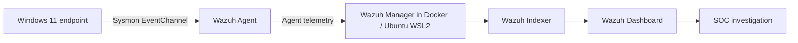
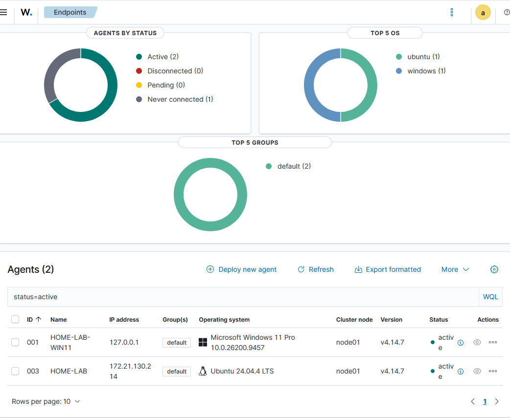
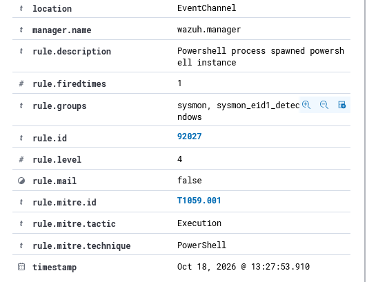
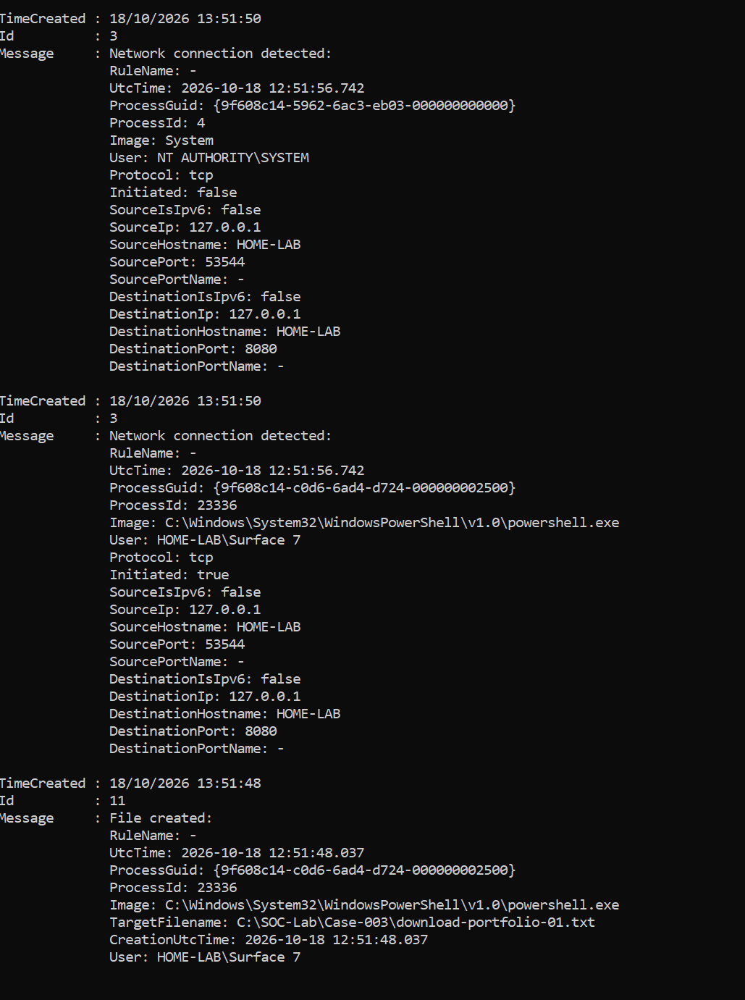

# Cybersecurity SIEM & Endpoint Detection Lab

**Practical SOC investigation, endpoint telemetry engineering, and detection validation using Wazuh, Sysmon, Windows 11, WSL2, Ubuntu and Docker.**

> **Status:** Investigations documented; endpoint event generation validated. A custom Wazuh alert for Case 003 was attempted but not confirmed. The October 18 Case 002 reproduction was confirmed in the Wazuh Dashboard. This repository makes that limitation explicit.

## Project overview

I built a home lab to develop practical SOC Analyst and Security Engineer skills. I used safe, controlled activity to examine how endpoint events are generated, correlated, and assessed. Rather than assuming every alert means an attack, I evaluated process ancestry, execution context, user, network endpoints, files, and the quality of available evidence.

## Architecture

The Docker stack uses Wazuh Manager, Indexer, and Dashboard version **4.14.7**. The Windows endpoint runs Sysmon **v15.21** and a Wazuh agent. This diagram describes the logical event flow, not a claim that every generated Case 003 event was confirmed in the indexer.

## Key outcomes

- Validated a Windows Wazuh agent as active and confirmed Sysmon EventChannel collection was configured.
- Examined a controlled PowerShell process creation scenario and its Wazuh detection (**Case 002**).
- Generated local HTTP network and file creation activity (**Case 003**).
- Resolved missing Sysmon Event ID 3 and 11 collection by enabling targeted rules.
- Correlated Case 003 Sysmon network and file activity using **ProcessGuid** and process ID.
- Investigated why the specific Case 003 events did not appear in the Wazuh alert dataset. Found that the relevant base Sysmon rules are level 0 and default alert conditions did not match the benign `.txt` file in the lab folder.
- Added experimental Wazuh rule **100100**, but did **not** confirm an alert from the live reproduction. Event ingestion versus rule matching remains unresolved.

## Investigations

| Case | Focus | Observed outcome |
|---|---|---|
| [002](cases/case-002-powershell.md) | PowerShell process creation | Sysmon Event ID 1; Wazuh rule 92027; authorized benign test |
| [003](cases/case-003-network-file-correlation.md) | Local HTTP request and file creation | Sysmon Event IDs 3 and 11 correlated; custom SIEM alert not confirmed |

## Analyst workflow

**Hypothesis → Triage → Evidence collection → Correlation → Contextual risk assessment → Verdict → Detection review → Documentation**

MITRE ATT&CK provides behavioral context, not proof of malicious activity. Case 002 maps to **T1059.001 (PowerShell)**. Case 003 resembles a download workflow but was a controlled localhost file transfer, not observed malicious ingress or malware execution.

## Evidence from October 18, 2026

The following screenshots were collected from the working home lab during a live reproduction. These contain local machine/account labels and should be reviewed before public release.

[Complete screenshot evidence index](screenshots/README.md)

## Technical evidence and methodology

- [Case 002 investigation](cases/case-002-powershell.md)
- [Case 003 investigation](cases/case-003-network-file-correlation.md)
- [Engineering findings and troubleshooting](docs/troubleshooting-and-lessons.md)
- [Validation commands](docs/validation-commands.md)
- [Evidence and screenshots checklist](screenshots/README.md)
- [Example Sysmon monitoring configuration](config/sysmon-case-003.xml)
- [Experimental Wazuh local rule](config/wazuh-local-rule-100100.xml)
- [Interview talking points](docs/interview-brief.md)

## Security and reproducibility

All exercises were authorized and performed in an isolated personal lab. The local HTTP request used `127.0.0.1:8080` and a harmless text file. This repository contains **sanitized examples**, not exported production credentials, authentication tokens, private keys, complete agent configurations, or raw personal identifiers. Review screenshots before committing.

The configuration examples are instructional and intentionally scoped to a controlled test. The Wazuh rule is **experimental, not production validated**.

## Future improvements

1. Establish end-to-end verification of event arrival at the Wazuh Manager using an intentionally scoped testing configuration and controlled full-event archiving.
2. Validate custom rule behavior against representative genuine EventChannel records before marking it operational.
3. Add any further evidence only after reviewing it for sensitive information.
4. Reconstruct Case 001 only after confirming its original commands, evidence and findings.

## Personal takeaway

A successful endpoint event does not automatically mean a successful SIEM detection. Effective SOC investigations distinguish **activity, telemetry, detection, and analyst judgment**.
