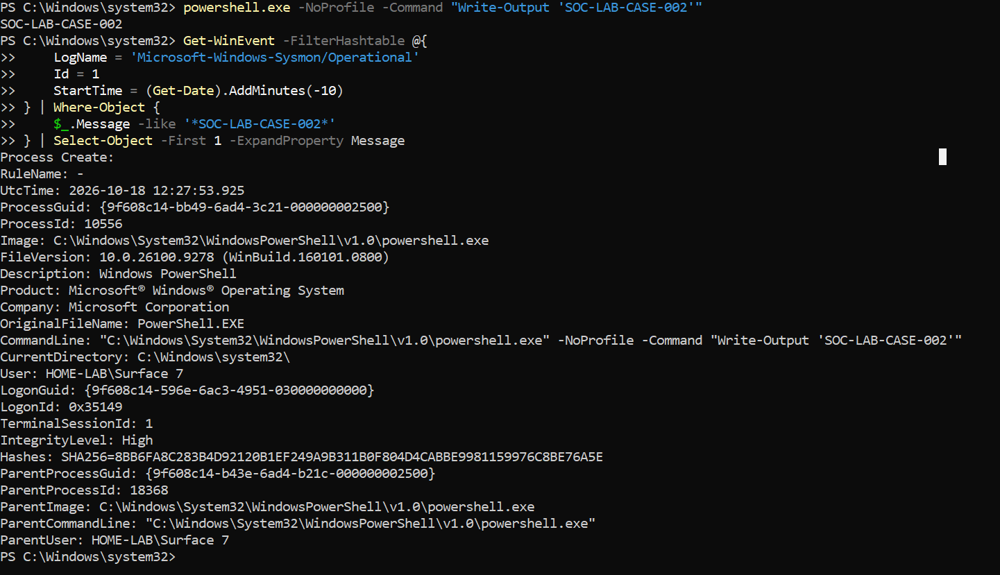
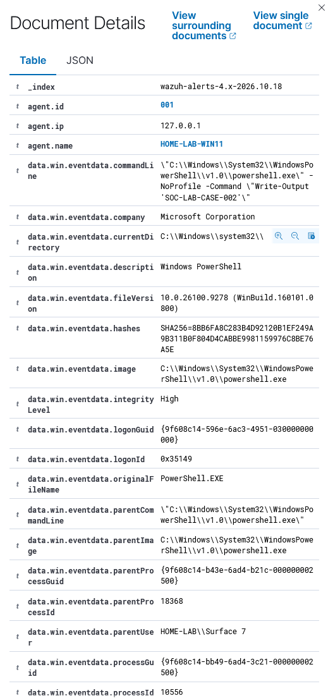

# Case 002: Controlled PowerShell Execution

**Reproduced:** 18 October 2026. **Verdict:** Benign authorised test. **End-to-end Wazuh detection:** Confirmed.

## Objective and execution

Validate PowerShell process creation telemetry and the Wazuh alert path. Executed in an elevated Windows PowerShell session:

```powershell
powershell.exe -NoProfile -Command "Write-Output 'SOC-LAB-CASE-002'"
```

The output was `SOC-LAB-CASE-002`, a harmless marker.

## Sysmon evidence

The matching Event ID 1 recorded UTC `2026-10-18 12:27:53.925`, child `powershell.exe` PID `10556`, parent `powershell.exe` PID `18368`, ProcessGuid `{9f608c14-bb49-6ad4-3c21-000000002500}`, `High` integrity, and the full benign `Write-Output` command line.



## SIEM verification

Wazuh Dashboard returned an alert in `wazuh-alerts-4.x-2026.10.18` for agent ID `001`, `HOME-LAB-WIN11`. It contained the matching ProcessGuid, PID and command line. Rule ID `92027`, level `4`, described a PowerShell process spawning another PowerShell instance, mapped to MITRE ATT&CK `T1059.001`, tactic Execution.




## Assessment

PowerShell execution and ATT&CK mapping are behavioral observations, not proof of an attack. This activity was explicitly authorised and contained no malicious payload. **Verdict: benign authorised activity**.

## Analyst takeaway

Correlate the original endpoint record to the SIEM alert using immutable process identifiers and command line context before making a security decision.
