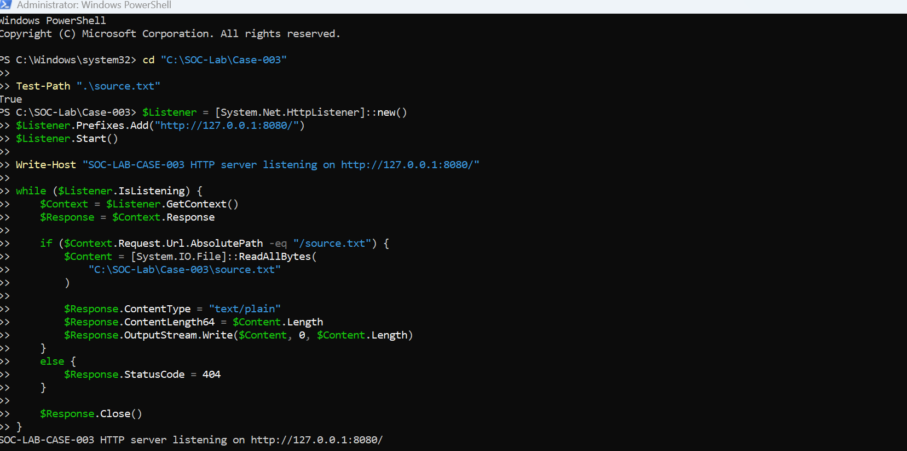
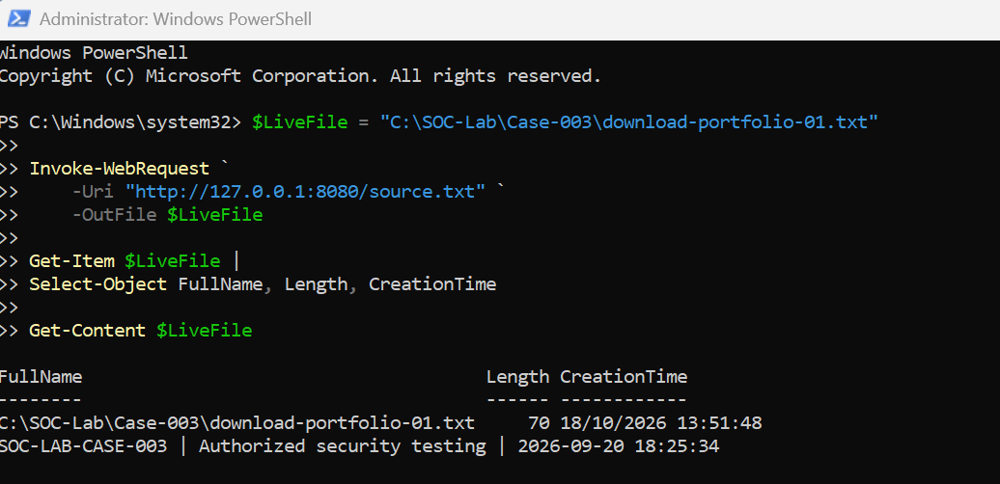
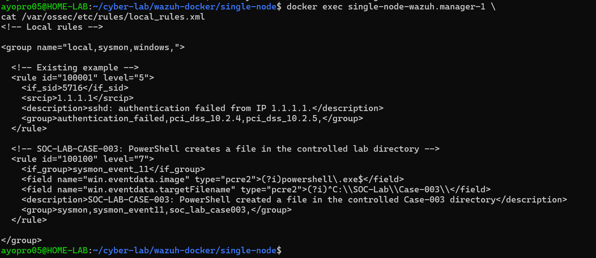

# Case 003: Controlled HTTP and File Creation Correlation

**Reproduced:** 18 October 2026. **Verdict:** Benign authorised simulation. **Endpoint telemetry:** Confirmed. **Custom Wazuh alert:** Not confirmed.

## Objective

Generate a localhost HTTP transfer from PowerShell and use Sysmon Event IDs 3 and 11 to correlate network and file activity by ProcessGuid.

## Test setup

A local .NET `HttpListener` served `C:\SOC-Lab\Case-003\source.txt` on `http://127.0.0.1:8080/`. The file contained an authorised test marker originally created September 20, 2026. The test did not contact an external server.



## Controlled download

```powershell
$LiveFile = "C:\SOC-Lab\Case-003\download-portfolio-01.txt"
Invoke-WebRequest -Uri "http://127.0.0.1:8080/source.txt" -OutFile $LiveFile
Get-Item $LiveFile | Select-Object FullName, Length, CreationTime
Get-Content $LiveFile
```

At local `13:51:48`, Windows created the destination text file (70 bytes). The content matched the known test marker.



## Sysmon findings

**Event ID 11:** FileCreate at UTC `2026-10-18 12:51:48.037`, PowerShell PID `23336`, ProcessGuid `{9f608c14-c0d6-6ad4-d724-000000002500}`, destination `C:\SOC-Lab\Case-003\download-portfolio-01.txt`.

**Event ID 3:** PowerShell PID `23336`, same ProcessGuid, initiated TCP connection from `127.0.0.1:53544` to `127.0.0.1:8080`. The event body reports UTC `2026-10-18 12:51:56.742`. A companion record from System PID 4 for the same socket was not another download.

**Timing caveat:** The file event's UTC time precedes the connection event's reported UTC time by about 8.7 seconds despite the known test workflow. Do not assert a millisecond-precise event ordering. The activity is correlated by common ProcessGuid, PID, context and test conditions.


## Engineering and visibility finding

Early investigation showed Sysmon network monitoring disabled, and later FileCreate rules were added. The verified active Sysmon configuration filters NetworkConnect to port 8080 and FileCreate to `C:\SOC-Lab\Case-003\`. These filters are lab-specific rather than full production coverage.

Wazuh base Sysmon rules `61605` (Event 3) and `61613` (Event 11) are level 0. An experimental custom rule `100100` was installed for PowerShell-created files under the Case 003 folder. **Its intended level 7 alert was not confirmed**, so the repository does not call this a successful detection. The Manager's `logall=no` and `logall_json=no` configuration means absence from `alerts.json` alone is not proof that the events were never received. Further rule and ingestion validation is future work.



## Final assessment

Localhost communication, a known harmless 70-byte text file and authorised test context support a **benign** verdict. The investigation demonstrated endpoint event correlation and exposed an unresolved SIEM detection validation gap.
